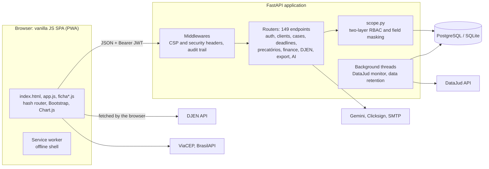

# LeoJuris

**Legal practice management for Brazilian law firms** — clients, lawsuits, federal
*precatórios*, business-day deadlines, court-gazette monitoring and fee splitting, in one
FastAPI + vanilla JavaScript application.

🇧🇷 [Leia em português](README.pt-BR.md)

> **Status: in production.** The private upstream of this repository runs a Brazilian law
> firm's day-to-day work. This public repository is a snapshot of the same code with a
> neutral brand (LeoJuris) and without the firm's internal operations documents.

---

## The problem

A small Brazilian law firm has to juggle things that generic CRMs don't model:

- **Deadlines are counted in business days**, skipping national holidays (some of them
  move with Easter) and the court recess of December 20 – January 20. A deadline miscounted
  by one day can lose a case.
- **Court notices are published in a national electronic gazette (DJEN).** Missing a
  publication means missing the deadline that starts with it.
- **Federal *precatórios* are a business line of their own:** leads come in by the hundreds
  from spreadsheets, go through a sales funnel, and carry personal data that must not leak
  between lawyers.
- **Fees are split** between a reserve, referral partners, a firm fund and the partners —
  and the books have to add up to the cent.
- All of this under **LGPD**, Brazil's data protection law.

LeoJuris covers that workflow end to end, with access control designed for an office where
admins, lawyers and interns see different slices of the same data.

### Glossary

| Term | Meaning |
|---|---|
| **Precatório** | A payment the government owes after a final court judgment, paid on a yearly schedule. Firms represent claimants (and heirs) and also buy these credits. Federal ones come from the five Federal Regional Courts (TRF1–TRF5). |
| **DJEN** | *Diário de Justiça Eletrônico Nacional* — the national electronic court gazette where notices (*intimações*) are published. Procedural deadlines run from these publications. |
| **DataJud** | Public API of the CNJ (National Council of Justice) with case metadata and docket movements. |
| **OAB** | The Brazilian Bar Association. Lawyers are identified by OAB number + state, e.g. `12345/AL`. |
| **LGPD** | *Lei Geral de Proteção de Dados* — Brazil's general data protection law, similar to the GDPR. |
| **CPF / CNPJ** | Taxpayer IDs for individuals (11 digits) and companies (14 digits), both with check digits. |
| **CNJ case number** | The unified 20-digit lawsuit number, `NNNNNNN-DD.YYYY.J.TR.OOOO`, with mod-97 check digits. |
| **CPC** | *Código de Processo Civil*, the Code of Civil Procedure (art. 220 sets the court recess; arts. 224/231 set how deadlines are counted). |
| **Estagiário** | Law intern — a user role with fixed restrictions. |
| **Honorários** | Attorney fees. |

---

## Features

- **Single client and case file** — a full-screen record with tabs for registration data,
  schedule (deadlines and hearings), documents, contacts, case parties, docket entries,
  service log, finance and a unified timeline. Every screen has a URL
  (`#/clientes/12?aba=agenda`), unsaved changes are guarded, and `Ctrl+K` opens a quick search.
- **Precatórios pipeline** — 10-stage sales funnel, classification (with release order,
  credit purchase, heirs, re-issue…), an unassigned-lead queue, a "stalled cases" report that
  lets the admin hand cases back to the queue, and Excel import with duplicate detection.
- **General lawsuits** (*ações gerais*) with their own funnel and areas of law.
- **Deadlines and agenda** with a business-day calculator and urgency levels.
- **Monitoring** — DataJud checks on a server schedule (with e-mail notification) and DJEN
  publications by OAB number, each with a suggested deadline and one-click linking to a
  client or case.
- **Finance** — fees, installments, PDF receipts and an automatic fee-split ledger.
- **Documents** — uploads, generated power-of-attorney and fee-agreement templates (PDF and
  .docx), and e-signature through Clicksign.
- **Executive dashboard** (Chart.js) with funnel conversion, legal and financial indicators,
  agenda and a per-lawyer productivity ranking.
- **Excel/PDF exports** that follow the on-screen filters (admin-only, audit-logged).
- **Optional AI module** (Google Gemini, admin-only): extract client/case data from PDFs and
  images, and ask questions about an aggregated snapshot of the office.
- **Users, permissions, 2FA and audit trail** screens.
- **Installable PWA** with an offline shell and light/dark themes.
- Address lookup by postal code (ViaCEP) and company lookup by CNPJ (BrasilAPI).

The user interface, code comments and API messages are in Brazilian Portuguese.

## Tech stack

| Layer | Technology |
|---|---|
| Backend | Python 3.11, FastAPI 0.141, Starlette 1.3, SQLAlchemy 2.0, Pydantic 2 |
| Database | PostgreSQL in production, SQLite for local development and tests |
| Auth | JWT (PyJWT, HS256) with server-side revocation, bcrypt, TOTP 2FA (pyotp) |
| Frontend | Vanilla JavaScript SPA (no framework, no build step), Bootstrap 5.3, Chart.js 4 |
| Documents | ReportLab (PDF), openpyxl (Excel), python-docx (.docx) |
| Integrations | DataJud and DJEN (CNJ public APIs), Clicksign, Google Gemini, SMTP, ViaCEP, BrasilAPI |
| Tests / CI | pytest + FastAPI TestClient, GitHub Actions |
| Deploy | Docker image (`python:3.11-slim`, non-root user) |

## Architecture



The backend serves the frontend as static files, so the app runs on a single origin.
There are 23 tables; schema changes are applied at startup (see *Operations* below).

```
backend/
  app/
    main.py            app, middlewares (CSP, audit), startup migrations, schedulers
    scope.py           access control: owner segregation, permissions, masking
    auth.py            JWT, password hashing, current user
    prazos.py          business-day deadline calculator
    distribuicao.py    fee-split engine
    comunica.py        DJEN client           ia.py   Gemini integration
    retencao.py        data retention job   marca.py   white-label branding
    routers/           one module per area (auth, clients, processes, precatorios, ...)
  tests/               pytest suite (temporary SQLite, network blocked)
  seed.py              sample data for local development
frontend/
  index.html, app.js   shell and core screens
  ficha*.js            hash router and the client/case file
  vendor/, assets/     self-hosted Bootstrap, icons, Chart.js, qrcodejs and fonts
Dockerfile, start.sh   production image
```

## Engineering highlights

Each item points to code you can read in this repository.

**Access control and data protection**

- **Two-layer RBAC** (`backend/app/scope.py`). Layer one is ownership: admins see
  everything, lawyers see their own records plus the queue of unassigned leads, interns
  assist the whole office. Layer two is per-user permissions: which modules a user can view or edit,
  and which precatório classifications and areas of law they reach. Both layers are enforced
  in the backend; the UI only hides what the API already refuses.
- **Intern profile with fixed locks** that not even an admin can lift: no finance module and
  no deletions. `tests/test_delete_estagiario.py` enumerates every `DELETE` route registered
  in the app and fails if a new route isn't listed and tested against the intern.
- **Masking of unassigned leads.** Personal fields of queue leads are hidden from lawyers on
  reads, on the `PUT` response, and on writes (masked fields are dropped from the payload, so
  saving a form with masked inputs doesn't erase stored data). Search can't be used as an
  oracle either: on masked leads, CPF/CNPJ only match the complete number
  (`scope.condicao_busca_documento`, `tests/test_busca_fila.py`).
- **IDOR checks on body parameters.** `client_id`/`process_id` sent in a request body are
  checked for ownership, not just module permission (`tests/test_idor.py`).

**Web security**

- **Content Security Policy without `'unsafe-inline'` scripts.** The two inline scripts are
  allowed by SHA-256 hashes computed from `index.html` at startup (with newline normalization,
  so Windows and Linux checkouts hash the same). There are no inline event handlers: UI
  actions use event delegation (`data-on-click` + `registrarAcoes`). Bootstrap, icons,
  Chart.js and fonts are self-hosted, so the CSP allows no third-party script, style or font
  origin, and `connect-src` lists only the public APIs the browser calls.
- **Stored-XSS defenses on both sides**: closed value lists validated on `Create`/`Update`
  schemas — never on the `Base` schema, so an unexpected legacy value can't turn a read
  screen into a 500 — and escaping on output, with a separate `escJs()` for values that end
  up inside JavaScript contexts.
- **Authentication**: JWTs carry a per-user `token_version`, bumped on password, role or
  permission changes, which revokes every open session. TOTP 2FA: replacing the secret
  requires the password and a current code, and the new secret stays pending until confirmed
  (`tests/test_2fa_troca.py`). Login, password and 2FA endpoints have sliding-window rate
  limits per IP and per account (`ratelimit.py`).
- **Fail-closed configuration**: with a PostgreSQL database the app refuses to start with the
  public development `SECRET_KEY`, without `ADMIN_PASSWORD`, or with `CORS_ORIGINS=*`.
- **Audit trail**: a middleware records every write; reads of sensitive records are logged
  explicitly; record names are resolved when the log is read, so old entries stay legible.
- **Exports** neutralize spreadsheet formula injection (`exportador.py`); **uploads** have a
  size limit and a magic-byte check against the file extension (`routers/documents.py`).
- **Dependencies** are pinned, including the transitive Starlette (pinned after CVEs that
  allowed unauthenticated memory DoS through the login form); `tests/test_pilha_http.py`
  covers the HTTP stack.

**Privacy (LGPD)**

- **Data retention job** (`retencao.py`) purges audit logs and archived DJEN publications
  after configurable periods, with minimum floors that protect features depending on that
  history.
- **AI without personal data where it isn't needed**: the spreadsheet-import summary sent to
  Gemini contains only aggregates, and `ia.conferir_sem_pii` raises if any personal-data key
  appears at any nesting level.
- No requests to third-party CDNs or font hosts, so users' IP addresses stay in-house.

**Domain logic**

- **Business-day calculator** (`prazos.py`): fixed national holidays, Easter-based ones
  (Carnival, Good Friday, Corpus Christi), the CPC art. 220 recess, and "today" computed in
  Brasília time regardless of the server's timezone. From a DJEN availability date it
  suggests publication date, start of counting and due date (Law 11.419/2006 art. 4,
  CPC arts. 224 and 231). The lawyer confirms the suggestion.
- **Fee-split engine** (`distribuicao.py`): a cascade over the amount actually received —
  reserve, then referral partner, then firm fund and partners. The last slice absorbs
  rounding so the ledger always adds up to the total; slices are stored in
  `honorario_rateios` and recalculated when the rule changes.
- **DJEN behind a geo-block.** The public API returns 403 to non-Brazilian server IPs but
  serves browsers in Brazil with permissive CORS. So the browser fetches the publications and
  the backend normalizes and deduplicates them. Permanently deleted publications
  leave a tombstone (`PublicacaoExcluida`) so the next sync can't bring them back.
- **Excel import of precatórios** detects duplicates by requisition number, court case
  number (digits only) and claimant name, and re-importing the same file is idempotent.

**Operations and testing**

- **Startup migrations without a migration tool**: idempotent `ALTER TABLE` statements plus
  `create_all`. If a required column is still missing, startup aborts: a broken deploy fails
  at boot, where the hosting platform keeps the previous version up, instead of serving
  errors on every query.
- **White-label branding** (`marca.py`): name, logos, PWA manifest, 2FA issuer and data
  protection officer contact come from one block, overridable by environment variables and
  always HTML-escaped. This repository is generated by swapping that block.
- **967 automated tests** in 23 modules. The suite runs on a temporary SQLite database with
  network access blocked (`tests/conftest.py`), so it never touches a real database or an
  external API; GitHub Actions runs it on every pull request.

## Running locally

Requires Python 3.11 (the version used by the Docker image and CI).

```bash
cd backend
python -m venv .venv
source .venv/bin/activate          # Windows: .venv\Scripts\activate
pip install -r requirements.txt
python seed.py                     # sample data; refuses to run against a non-SQLite database
uvicorn app.main:app --reload      # http://127.0.0.1:8000
```

Sample logins (local SQLite only):

| Role | E-mail | Password |
|---|---|---|
| Admin | `admin@escritorio.com` | `admin123` |
| Lawyer | `marina@escritorio.com` | `marina123` |

The interactive API docs are at `/docs` when running on SQLite (or with `CRM_DOCS=1`).

## Running the tests

```bash
cd backend
pytest                             # 967 passed
```

Optional frontend check (Node.js): the five scripts share one global scope, so they are
checked together, and a function name declared twice must not exist.

```bash
cd frontend
cat app.js ficha.js ficha-modulos.js ficha-cliente.js ficha-processo.js > /tmp/all.js
node --check /tmp/all.js
grep -ohE '^(async )?function [A-Za-z_$]+' *.js | sort | uniq -d   # must print nothing
```

## Configuration

Everything is read from environment variables; none is needed for local development.

| Variable | Purpose |
|---|---|
| `DATABASE_URL` | PostgreSQL URL. Without it, SQLite (`backend/crm.db`) is used. |
| `SECRET_KEY` | JWT signing key. Required in production. |
| `ADMIN_EMAIL`, `ADMIN_PASSWORD` | Initial admin, created on first start. Password required in production. |
| `CORS_ORIGINS` | Comma-separated allowed origins. `*` is rejected in production. |
| `GEMINI_API_KEY`, `GEMINI_MODEL` | Enable the optional AI module. |
| `SMTP_HOST`, `SMTP_PORT`, `SMTP_USER`, `SMTP_PASS`, `SMTP_FROM`, `MONITOR_NOTIFY_EMAIL` | E-mail notifications. |
| `CLICKSIGN_ACCESS_TOKEN`, `CLICKSIGN_API_URL` | E-signature integration. |
| `DATAJUD_API_KEY`, `MONITOR_INTERVAL_HOURS`, `MONITOR_AUTOCHECK` | DataJud monitoring (the default key is the public one published by the CNJ). |
| `RETENCAO_AUTOEXEC` | Toggle for the data retention job. |
| `MARCA_*`, `LGPD_ENCARREGADO_NOME`, `LGPD_ENCARREGADO_EMAIL` | Branding and data protection officer contact (see `backend/app/marca.py`). |
| `CRM_DOCS` | `1` exposes `/docs` outside SQLite. |

## Deployment

`Dockerfile` builds the production image: `python:3.11-slim`, dependencies installed in a
cached layer, the app running as an unprivileged user, and `start.sh` launching uvicorn on
`$PORT`. In production the image runs on a PaaS with a managed PostgreSQL database; set at
least `DATABASE_URL`, `SECRET_KEY`, `ADMIN_EMAIL`, `ADMIN_PASSWORD` and `CORS_ORIGINS`.

## Known limitations

- Uploaded files are stored on the local disk (`backend/uploads`); hosts with ephemeral
  disks need a persistent volume.
- DJEN publications are fetched when a user opens the app (because of the geo-block), not
  around the clock on the server.
- The rate limiter keeps its counters in memory, which fits a single-instance deployment.
- Only national holidays are built in; state, municipal and court-specific holidays are not,
  which is why deadlines are presented as suggestions.

## License

The source code is released under the [MIT License](LICENSE).

The **LeoJuris** name and logo, as well as other brand assets, texts and artwork, are not
covered by the MIT License — all rights reserved. Third-party files keep their own licenses:
Bootstrap, Bootstrap Icons, Chart.js and qrcodejs (MIT) in `frontend/vendor/`, and the
Manrope and Sora fonts (SIL Open Font License 1.1) in `frontend/assets/fontes/`.

Security issues: see [SECURITY.md](SECURITY.md). Contributions: see
[CONTRIBUTING.md](CONTRIBUTING.md).
