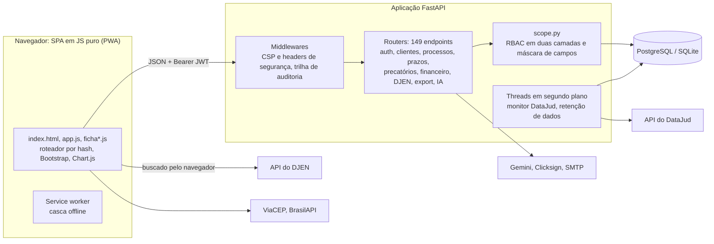

# LeoJuris

**Gestão jurídica para escritórios de advocacia brasileiros** — clientes, processos,
precatórios federais, prazos em dias úteis, monitoramento do Diário de Justiça e rateio de
honorários, numa aplicação FastAPI + JavaScript puro.

🇺🇸 [Read in English](README.md)

> **Status: em produção.** O repositório privado de origem roda o dia a dia de um escritório
> de advocacia brasileiro. Este repositório público é uma cópia do mesmo código com uma marca
> neutra (LeoJuris) e sem os documentos internos de operação do escritório.

---

## O problema

Um escritório pequeno precisa lidar com coisas que um CRM genérico não modela:

- **Prazos contam em dias úteis**, pulando feriados nacionais (alguns mudam com a Páscoa) e a
  suspensão de 20 de dezembro a 20 de janeiro. Um dia errado na contagem pode perder a causa.
- **As intimações saem no Diário de Justiça Eletrônico Nacional (DJEN).** Perder uma
  publicação é perder o prazo que começa com ela.
- **Precatório federal é uma linha de negócio própria:** os leads chegam às centenas por
  planilha, passam por um funil comercial e carregam dados pessoais que não podem vazar
  entre advogados.
- **Honorários são rateados** entre caixa reserva, parceiros, fundo do escritório e sócios —
  e a conta tem que fechar no centavo.
- Tudo isso sob a **LGPD**.

O LeoJuris cobre esse fluxo de ponta a ponta, com controle de acesso pensado para um
escritório em que administrador, advogado e estagiário enxergam recortes diferentes dos
mesmos dados.

### Glossário

| Termo | Significado |
|---|---|
| **Precatório** | Pagamento devido pelo poder público depois de condenação definitiva, quitado em calendário anual. Escritórios representam credores (e herdeiros) e também compram esses créditos. Os federais vêm dos cinco Tribunais Regionais Federais (TRF1–TRF5). |
| **DJEN** | Diário de Justiça Eletrônico Nacional, onde as intimações são publicadas. Os prazos processuais correm a partir dessas publicações. |
| **DataJud** | API pública do CNJ (Conselho Nacional de Justiça) com dados e movimentações de processos. |
| **OAB** | Ordem dos Advogados do Brasil. O advogado é identificado por número + UF, ex.: `12345/AL`. |
| **LGPD** | Lei Geral de Proteção de Dados, equivalente brasileiro do GDPR. |
| **CPF / CNPJ** | Cadastros de pessoa física (11 dígitos) e jurídica (14 dígitos), ambos com dígito verificador. |
| **Número CNJ** | Numeração única de processo, `NNNNNNN-DD.AAAA.J.TR.OOOO`, com dígito verificador módulo 97. |
| **CPC** | Código de Processo Civil (art. 220: suspensão de fim de ano; arts. 224/231: contagem de prazo). |
| **Estagiário** | Perfil de usuário com restrições fixas. |
| **Honorários** | Remuneração do advogado. |

---

## Funcionalidades

- **Ficha única de cliente e de processo** — registro em tela inteira com abas de cadastro,
  agenda (prazos e audiências), documentos, contatos, partes, andamentos, atendimentos,
  financeiro e linha do tempo unificada. Toda tela tem endereço
  (`#/clientes/12?aba=agenda`), alteração não salva é protegida e `Ctrl+K` abre a busca rápida.
- **Funil de precatórios** — 10 etapas, classificação (com alvará, compra de crédito,
  habilitação de herdeiros, reexpedição…), fila de leads sem responsável, relatório de casos
  parados que permite ao admin devolvê-los à fila, e importação de Excel com detecção de
  duplicados.
- **Ações gerais**, com funil e áreas do direito próprios.
- **Prazos e agenda** com cálculo em dias úteis e nível de urgência.
- **Monitoramento** — consulta ao DataJud agendada no servidor (com aviso por e-mail) e
  publicações do DJEN por número de OAB, cada uma com prazo sugerido e vínculo em um clique a
  cliente ou processo.
- **Financeiro** — honorários, parcelamento, recibo em PDF e livro-razão do rateio automático.
- **Documentos** — upload, modelos de procuração e contrato de honorários (PDF e .docx) e
  assinatura eletrônica pela Clicksign.
- **Dashboard executivo** (Chart.js) com conversão do funil, indicadores jurídicos e
  financeiros, agenda e ranking de produtividade por advogado.
- **Exportação Excel/PDF** que segue os filtros da tela (só admin, registrada na auditoria).
- **Módulo de IA opcional** (Google Gemini, só admin): extrai dados de cliente/processo de PDF
  e imagem, e responde perguntas sobre um retrato agregado do escritório.
- Telas de **usuários, permissões, 2FA e trilha de auditoria**.
- **PWA instalável**, com casca offline e tema claro/escuro.
- Busca de endereço por CEP (ViaCEP) e de empresa por CNPJ (BrasilAPI).

## Tecnologias

| Camada | Tecnologia |
|---|---|
| Backend | Python 3.11, FastAPI 0.141, Starlette 1.3, SQLAlchemy 2.0, Pydantic 2 |
| Banco | PostgreSQL em produção, SQLite no desenvolvimento e nos testes |
| Autenticação | JWT (PyJWT, HS256) com revogação no servidor, bcrypt, 2FA TOTP (pyotp) |
| Frontend | SPA em JavaScript puro (sem framework, sem build), Bootstrap 5.3, Chart.js 4 |
| Documentos | ReportLab (PDF), openpyxl (Excel), python-docx (.docx) |
| Integrações | DataJud e DJEN (APIs públicas do CNJ), Clicksign, Google Gemini, SMTP, ViaCEP, BrasilAPI |
| Testes / CI | pytest + TestClient do FastAPI, GitHub Actions |
| Deploy | Imagem Docker (`python:3.11-slim`, usuário sem privilégio) |

## Arquitetura



O backend serve o frontend como arquivos estáticos, então tudo roda numa origem só. São 23
tabelas; mudanças de esquema são aplicadas na subida (ver *Operação* abaixo).

```
backend/
  app/
    main.py            app, middlewares (CSP, auditoria), migrações na subida, agendadores
    scope.py           controle de acesso: dono, permissões, máscara
    auth.py            JWT, hash de senha, usuário corrente
    prazos.py          cálculo de prazos em dias úteis
    distribuicao.py    motor de rateio de honorários
    comunica.py        cliente do DJEN         ia.py   integração com o Gemini
    retencao.py        rotina de retenção      marca.py   marca configurável
    routers/           um módulo por área (auth, clients, processes, precatorios, ...)
  tests/               suíte pytest (SQLite temporário, rede bloqueada)
  seed.py              dados de exemplo para desenvolvimento
frontend/
  index.html, app.js   casca e telas principais
  ficha*.js            roteador por hash e a ficha de cliente/processo
  vendor/, assets/     Bootstrap, ícones, Chart.js, qrcodejs e fontes auto-hospedados
Dockerfile, start.sh   imagem de produção
```

## Destaques de engenharia

Cada item aponta para código que está neste repositório.

**Controle de acesso e proteção de dados**

- **RBAC em duas camadas** (`backend/app/scope.py`). A primeira é o dono: o admin vê tudo, o
  advogado vê os próprios registros mais a fila de leads sem responsável, o estagiário
  assiste o escritório inteiro. A segunda são as permissões por usuário: quais módulos ele vê
  ou edita, e quais classificações de precatório e áreas de ação alcança. As duas valem no
  backend; a tela só esconde o que a API já recusa.
- **Perfil estagiário com travas fixas**, que nem o admin libera: sem módulo financeiro e sem
  exclusão. `tests/test_delete_estagiario.py` enumera toda rota `DELETE` registrada no app e
  falha se uma rota nova não estiver listada e testada contra o estagiário.
- **Máscara dos leads da fila.** Os dados pessoais de lead sem dono ficam ocultos para o
  advogado na leitura, na resposta do `PUT` e na escrita (o campo mascarado sai do payload,
  então salvar o formulário não apaga o dado gravado). A busca também não vira oráculo: em
  lead mascarado, CPF/CNPJ só casa com o número completo (`scope.condicao_busca_documento`,
  `tests/test_busca_fila.py`).
- **IDOR em parâmetro do corpo.** `client_id`/`process_id` enviados no corpo passam por
  checagem de dono, não só de permissão do módulo (`tests/test_idor.py`).

**Segurança web**

- **Content Security Policy sem `'unsafe-inline'` em script.** Os dois scripts inline são
  liberados por hash SHA-256 calculado do `index.html` na subida (com normalização de quebra
  de linha, para Windows e Linux darem o mesmo hash). Não há handler inline: as ações da tela
  usam delegação de eventos (`data-on-click` + `registrarAcoes`). Bootstrap, ícones, Chart.js
  e fontes são servidos pelo próprio app, então a CSP não libera origem de terceiros para
  script, estilo ou fonte, e o `connect-src` lista só as APIs públicas que o navegador chama.
- **Defesa contra XSS armazenado dos dois lados**: listas fechadas validadas nos schemas de
  `Create`/`Update` — nunca no `Base`, para um valor antigo inesperado não derrubar uma tela de
  leitura com erro 500 — e escape na saída, com um `escJs()` próprio para valor que vai parar
  dentro de JavaScript.
- **Autenticação**: o JWT carrega um `token_version` por usuário, incrementado na troca de
  senha, papel ou permissões, o que revoga todas as sessões abertas. 2FA TOTP: trocar o
  segredo exige a senha e um código atual, e o segredo novo fica pendente até ser confirmado
  (`tests/test_2fa_troca.py`). Login, senha e 2FA têm limite de tentativas por IP e por conta
  em janela deslizante (`ratelimit.py`).
- **Configuração que falha fechada**: com banco PostgreSQL o app se recusa a subir com a
  `SECRET_KEY` pública de desenvolvimento, sem `ADMIN_PASSWORD` ou com `CORS_ORIGINS=*`.
- **Trilha de auditoria**: um middleware registra toda escrita; a leitura de registro
  sensível é registrada explicitamente; o nome do registro é resolvido na leitura do log, então
  o histórico antigo continua legível.
- **Exportação** neutraliza injeção de fórmula em planilha (`exportador.py`); **upload** tem
  limite de tamanho e conferência dos bytes iniciais contra a extensão (`routers/documents.py`).
- **Dependências** fixadas, inclusive a Starlette transitiva (fixada depois de CVEs que
  permitiam esgotar a memória sem login pelo formulário de login); `tests/test_pilha_http.py`
  cobre a pilha HTTP.

**Privacidade (LGPD)**

- **Rotina de retenção** (`retencao.py`): expurga trilha de auditoria e publicações do DJEN
  arquivadas depois de prazos configuráveis, com pisos mínimos que protegem as funções que
  dependem desse histórico.
- **IA sem dado pessoal onde ele não é necessário**: o resumo da importação de planilha
  enviado ao Gemini tem só agregados, e `ia.conferir_sem_pii` levanta erro se aparecer chave
  de dado pessoal em qualquer nível.
- Nenhuma requisição a CDN ou servidor de fontes de terceiros: o IP de quem usa o sistema não
  sai do escritório.

**Regras de negócio**

- **Prazos em dias úteis** (`prazos.py`): feriados nacionais fixos e móveis (Carnaval,
  Sexta-feira Santa, Corpus Christi, derivados da Páscoa), a suspensão do art. 220 do CPC e o
  "hoje" calculado no horário de Brasília, seja qual for o fuso do servidor. A partir da data
  de disponibilização no DJEN, sugere publicação, início da contagem e vencimento
  (Lei 11.419/2006 art. 4º, CPC arts. 224 e 231). O advogado confirma a sugestão.
- **Rateio de honorários** (`distribuicao.py`): cascata sobre o valor efetivamente recebido —
  caixa reserva, depois parceiro, depois fundo do escritório e sócios. A última fatia absorve
  o arredondamento, então o livro-razão sempre fecha com o total; as fatias ficam em
  `honorario_rateios` e são recalculadas quando a regra muda.
- **DJEN atrás de bloqueio geográfico.** A API pública responde 403 a servidor fora do Brasil,
  mas atende o navegador no Brasil com CORS liberado. Por isso o navegador busca as
  publicações e o backend normaliza e elimina duplicadas. Publicação excluída em definitivo
  deixa uma marca (`PublicacaoExcluida`) para a próxima sincronização não trazê-la de volta.
- **Importação de precatórios por Excel** detecta duplicados por número do requisitório,
  número do processo (só os dígitos) e nome do requerente, e reimportar a mesma planilha é
  idempotente.

**Operação e testes**

- **Migração na subida, sem ferramenta de migração**: `ALTER TABLE` idempotentes mais
  `create_all`. Se uma coluna obrigatória continuar faltando, a subida é abortada: o deploy
  quebrado falha no boot, onde a plataforma mantém a versão anterior no ar, em vez de
  responder erro a cada consulta.
- **Marca configurável** (`marca.py`): nome, logos, manifesto do PWA, emissor do 2FA e contato
  do encarregado de dados saem de um bloco só, trocável por variável de ambiente e sempre
  escapado no HTML. Este repositório é gerado trocando esse bloco.
- **967 testes automatizados** em 23 módulos. A suíte roda num SQLite temporário com a rede
  bloqueada (`tests/conftest.py`), então nunca toca banco real nem API externa; o GitHub
  Actions a executa em cada pull request.

## Como rodar localmente

Requer Python 3.11 (a versão da imagem Docker e do CI).

```bash
cd backend
python -m venv .venv
source .venv/bin/activate          # Windows: .venv\Scripts\activate
pip install -r requirements.txt
python seed.py                     # dados de exemplo; recusa rodar fora do SQLite
uvicorn app.main:app --reload      # http://127.0.0.1:8000
```

Logins de exemplo (só no SQLite local):

| Perfil | E-mail | Senha |
|---|---|---|
| Admin | `admin@escritorio.com` | `admin123` |
| Advogado | `marina@escritorio.com` | `marina123` |

A documentação interativa da API fica em `/docs` quando o banco é SQLite (ou com `CRM_DOCS=1`).

## Como rodar os testes

```bash
cd backend
pytest                             # 967 passed
```

Checagem opcional do frontend (Node.js): os cinco scripts dividem o mesmo escopo global, então
são checados juntos, e não pode existir função declarada duas vezes.

```bash
cd frontend
cat app.js ficha.js ficha-modulos.js ficha-cliente.js ficha-processo.js > /tmp/all.js
node --check /tmp/all.js
grep -ohE '^(async )?function [A-Za-z_$]+' *.js | sort | uniq -d   # não pode imprimir nada
```

## Configuração

Tudo vem de variáveis de ambiente; nenhuma é necessária para desenvolver localmente.

| Variável | Para quê |
|---|---|
| `DATABASE_URL` | URL do PostgreSQL. Sem ela, usa SQLite (`backend/crm.db`). |
| `SECRET_KEY` | Chave que assina os JWT. Obrigatória em produção. |
| `ADMIN_EMAIL`, `ADMIN_PASSWORD` | Admin inicial, criado na primeira subida. Senha obrigatória em produção. |
| `CORS_ORIGINS` | Origens permitidas, separadas por vírgula. `*` é recusado em produção. |
| `GEMINI_API_KEY`, `GEMINI_MODEL` | Ligam o módulo de IA opcional. |
| `SMTP_HOST`, `SMTP_PORT`, `SMTP_USER`, `SMTP_PASS`, `SMTP_FROM`, `MONITOR_NOTIFY_EMAIL` | Avisos por e-mail. |
| `CLICKSIGN_ACCESS_TOKEN`, `CLICKSIGN_API_URL` | Assinatura eletrônica. |
| `DATAJUD_API_KEY`, `MONITOR_INTERVAL_HOURS`, `MONITOR_AUTOCHECK` | Monitoramento DataJud (a chave padrão é a pública divulgada pelo CNJ). |
| `RETENCAO_AUTOEXEC` | Liga/desliga a rotina de retenção. |
| `MARCA_*`, `LGPD_ENCARREGADO_NOME`, `LGPD_ENCARREGADO_EMAIL` | Marca e contato do encarregado de dados (ver `backend/app/marca.py`). |
| `CRM_DOCS` | `1` abre o `/docs` fora do SQLite. |

## Deploy

O `Dockerfile` gera a imagem de produção: `python:3.11-slim`, dependências numa camada
cacheada, o app rodando com usuário sem privilégio e o `start.sh` subindo o uvicorn na porta
`$PORT`. Em produção a imagem roda numa PaaS com PostgreSQL gerenciado; defina pelo menos
`DATABASE_URL`, `SECRET_KEY`, `ADMIN_EMAIL`, `ADMIN_PASSWORD` e `CORS_ORIGINS`.

## Limitações conhecidas

- Os arquivos enviados ficam no disco local (`backend/uploads`); em hospedagem com disco
  efêmero é preciso um volume persistente.
- As publicações do DJEN são buscadas quando alguém abre o sistema (por causa do bloqueio
  geográfico), não 24 horas por dia no servidor.
- O limitador de tentativas guarda os contadores em memória, o que serve para uma instância só.
- Só os feriados nacionais estão embutidos; os estaduais, municipais e forenses não, e por isso
  o prazo é apresentado como sugestão.

## Licença

O código-fonte é distribuído sob a [Licença MIT](LICENSE).

O nome e o logo **LeoJuris**, assim como as demais peças de marca, textos e arte, não estão
cobertos pela Licença MIT — todos os direitos reservados. Arquivos de terceiros mantêm as
próprias licenças: Bootstrap, Bootstrap Icons, Chart.js e qrcodejs (MIT) em
`frontend/vendor/`, e as fontes Manrope e Sora (SIL Open Font License 1.1) em
`frontend/assets/fontes/`.

Vulnerabilidades: ver [SECURITY.md](SECURITY.md). Contribuições: ver
[CONTRIBUTING.md](CONTRIBUTING.md).
